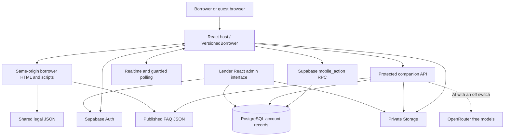

# Architecture and Technical Requirements

Baseline: October 14, 2026. Component design: [SDD](SDD.md). Contracts: [SRS](SRS.md).

## System map

## Trust boundaries

The browser frame is a presentation layer. The React host verifies frame origin/source and owns session tokens. Supabase Auth identifies the user; database policies and mutation functions enforce account scope. The companion API validates active profiles and keeps privileged keys on the server. Guest support is constrained and cannot accept arbitrary borrower ownership.

Pawcheebels has no database lookup dependency of its own. Its active-user check establishes whether external AI may be used, not permission to send ledger records. The provider sees server-selected public FAQ text and the user’s current question. Neither bearer token nor ledger/conversation snapshot enters that request. The assistant cannot call the mutation RPC.

## Data domains

| Domain | Main records |
| --- | --- |
| Account | profiles, borrower preferences, Auth sessions, login tokens |
| Ledger | loans, transactions, payments, payment logs, due configuration/overrides |
| Requests | loan requests, events, rates/access, disbursements |
| Documents | invoices, borrower statements, private proof/attachment/avatar objects |
| Communication | messages, notifications, reads, reactions, hidden messages |
| Support | support tickets/events, optional screenshots |
| Integrity | operation keys, verified uploads, audit history |

Other administration domains include wallet, arbitrage and loan tracking. Their migration files and screens remain in the repository, but the current borrower FAQ change does not certify their flows.

## Read and write paths

Authenticated contexts read authorized account data and build the borrower snapshot. Presentation adapts those rows into cards and lists, keeping transaction/due/paid dates separate. Realtime plus guarded polling refreshes account data. Stable snapshot comparison suppresses equivalent frame deliveries, and selected interactions update only the affected portion rather than replacing the whole dashboard.

For writes, the frame issues an allowed mobile-call with a request key. React performs authentication-dependent handling and calls an authorized RPC or companion API. Uploads pass client type/size/magic checks, private Storage upload and server verification where required. Confirmation follows the durable result; lost responses retain retry keys.

Guest support writes use the companion service’s transaction and retry key. Signed support uses the authenticated action service. Messages use the account conversation. Notification replies route into messaging; reactions are separate feedback records. Invoice deletion preserves a deletion timestamp.

## Service hosting and operations

Host the browser interface and protected companion APIs under HTTPS. A static browser build does not execute server request handlers; the hosting configuration must provide those APIs and their authenticated database connections. Keep database administration and service credentials inaccessible to borrower browsers. The Expo interface has its own build and release lifecycle.

Required services are the web host, Supabase Auth/database/Storage, valid server configuration and network connectivity. Pawcheebels’ AI mode uses OpenRouter with free-model routing; FAQ does not depend on an external provider. Reload the server processes after changing credentials or server-loaded FAQ content, and publish updated browser assets through the release process.

Operations maintains operator contact details, retention controls, endpoint availability, backup/recovery, device compatibility and monitored performance targets. User-visible messages must distinguish confirmed account actions, document handoff and advisory guidance. See [TDD](TDD.md) for acceptance and recovery requirements.

## Payment confirmation boundary

The borrower presentation module consumes the existing confirmed submission response and requested-allocation snapshot. It requires no additional bank-data capture, database migration, external rendering service or autonomous message sending. The authenticated owner is captured before asynchronous submission and checked before displaying or exporting the confirmation. Device sharing is a user-operated browser capability; file delivery retains the existing app feedback flow.

## Presentation continuity

Authentication lifecycle events and record refreshes are separate concerns. Same-identity reconfirmation does not create a new login, and only confirmed sign-out clears identity-owned presentation state. Borrower-facing server processes do not automatically reload open screens when new assets are published; refreshed assets are loaded on deliberate browser navigation. Generated verification reports and graph output are excluded from the development watcher.

## Payment draft boundary

Unsubmitted proof bytes remain in borrower-keyed browser storage and are never automatically sent. Saved server submissions and device drafts are distinct. Authentication ownership gates draft restoration, and current server-visible item records revalidate restored allocations. Browser storage failure preserves in-tab state with a visible notice. Root React feedback and borrower presentation feedback share the same CSS motion vocabulary without replacing document loading.

## Account reference ownership

Numeric account references are assigned by the database, then carried as text through the authenticated profile mapper. They do not replace the keys used for ownership, storage or financial relationships. The private allocation counter uses atomic updates and is not exposed through the Data API. UI code reads the assigned reference and never guesses a unique number from name data.

## Login illustration entry

The main app and login-illustration.html are separate Vite build entries. The second page mounts React and Remotion Player using matched remotion and @remotion/player versions, pinned to 4.0.534. LoginIllustration uses useCurrentFrame/useVideoConfig and frame-driven SVG transforms over the original PNG. It runs in a same-origin presentation iframe without account or credential data. Parent readiness messages verify origin, source window, channel and event type before revealing the Player. The static SVG provides the loading/failure fallback. Deployment includes the app and illustration HTML entries and their emitted assets. Remotion use follows the provider licensing terms: https://www.remotion.dev/license.

## Protected badge readiness

The Protected badge retains its label and changes from a neutral state to a green pill with a shield checkmark when the email format is valid and the password is nonempty. A 1.8-second shield/halo pulse makes that change visible; the checkmark draws on activation. Clearing either field or entering an invalid email resets the badge. A polite accessible status announces only readiness changes. The tooltip explains that sign-in is still required to authenticate; this state does not verify credentials or confirm authentication.

Input and change events update readiness immediately. A login-only 250 ms check detects password manager fills that emit neither event, synchronizing the badge, floating labels and sign-in button. It skips hidden documents, stops on navigation and is replaced rather than duplicated on render. Credential values remain in the existing form DOM and are neither retained nor persisted by the observer.

Reduced-motion preference stops the pulse and checkmark drawing while preserving the green ready state and completed checkmark. Dark appearance uses a contrasting green surface. Placement below the password and the existing input spacing remain.

## Dashboard balance status badges

A compact status pill sits beside the active balance card's eyebrow above the amount. Current Balance Due shows ON-SCHEDULE in green when it has no overdue unpaid charges, or PAST DUE in red when any positive unpaid charge has a due date before today. Next Balance Due shows UPCOMING in blue for positive unpaid charges due today or later. If a Next charge has become overdue, PAST DUE takes priority. An empty or credit-only Next balance has no Upcoming badge.

Classification uses only the selected card's positive unpaid charges and valid calendar dates, with today's date in Asia/Manila, matching the dashboard advisory. Paid, refunded, cancelled, zero and negative rows cannot create a past-due or upcoming badge. Due today is not past due; the grace period does not change the overdue date classification.

The colored dot and surrounding halo pulse on a 1.8-second loop through transform and opacity, keeping the text and layout stable. Reduced-motion preference removes the pulse while retaining the status text, color and dot. The badge includes an accessible status label and explanatory tooltip. The compact heading adapts to narrow screens.

The badge belongs to balance-content, so existing tab switches replace it with the selected card's content while retaining the rest of Dashboard. Initial render and later snapshots derive status from current presentation data. The badge does not change transactions, payment allocations or account records.

## Borrower account reveal and copy

Dashboard, personal information and floating chat account labels start masked, showing bullets and only the account number's last four digits. An eye button reveals the full numeric reference and changes to a copy button. Copy writes the exact number, including leading zeros, to the clipboard and gives success or failure feedback while the action remains current. Unassigned accounts show Not assigned without a reveal/copy button.

The four-second conceal timer starts when the copy button is clicked, including clipboard prompts or failures. At expiry the label returns to its last-four mask and the button returns to the reveal icon. A retry replaces the timer. Revealing alone does not start the timer. Navigation, full presentation render, document hiding and page exit reset revealed controls and clear outstanding timers. The existing partial balance-tab switch retains the footer control and its active timer.

The copy action is disabled while pending. Async completion is guarded by the current owner, connected control and operation generation; expired, superseded or detached actions cannot update the new view. Clipboard API is used in secure contexts, with a temporary textarea fallback where needed. The fallback restores focus without scrolling and removes its temporary field. No full number is placed in masked markup, action labels or data attributes, and reveal state is not persisted. The underlying account identifier and saved receipt/disclosure data retain their actual values.

The icon button has a 32px target, keyboard-accessible reveal/copy labels, a focus ring and an explanatory tooltip. Account text can wrap on narrow layouts. Dashboard icons contrast with the balance surface; reduced motion removes their background transition.

## Login Aurora presentation boundary

Historical implementation: the free React Bits Aurora background was selected after the owner confirmed they do not have a Pro license. The current update below removes this background and restores the original gradient. The original animated illustration is transparent: its SVG sky and whole-image backdrop are removed, while the original pixel clips for paper, shield, lock, coin and checkmark remain. The platform and decorative curves remain visible. The lock opening, illustration host and iframe document are transparent. The static fallback follows the same foreground composition, so Aurora shows through during loading as well as playback. Branding, form behavior and footers remain intact.

The Protected pill has a minimum height of 24 px, 4 px vertical and 9 px horizontal padding, and a 5 px icon/text gap. Its icon and text use a 14 px line box and share their vertical center. Explicit span font and margin resets prevent form-label styling from shifting the text. Existing valid-email/nonempty-password readiness and reduced-motion behavior continue.

A dedicated same-origin login-background.html entry mounts the free Aurora component behind the borrower login. Theme communication contains only a boolean and verifies the sending window and origin. The frame has no account or credential input, no pointer interaction and no keyboard focus. Login navigation removes its layer. The React error boundary leaves the parent static gradient visible if rendering fails; the component handles absent WebGL2, visibility and resource cleanup. The current deployment includes the app and illustration HTML entries and their emitted assets.

## Borrower presentation and localization update

The login background returns to the original quiet gradient. Aurora is no longer mounted or included as a build entry. The transparent foreground illustration, automatic Remotion loop, app logo and footers remain. A fresh successful password response starts the authentication matrix while the profile and Dashboard prepare; the first ready borrower snapshot is delivered immediately. The matrix still holds for at least four seconds and fades for 450 ms when data is ready. Failed sign-in does not trigger success feedback. A missing or disabled profile dismisses the matrix. Authentication failures release the pending state. Restored sessions retain their existing continuity behavior.

Revealing a borrower account number starts a fixed four-second conceal deadline. Copying does not extend it, including delayed or failed clipboard requests. Navigation, owner changes, rendering and hidden pages retain the existing conceal safeguards.

Transactions, More → Installment Transactions and Loan Profile offer List and Cards. Cards overlap in a deck with swipe/drag, previous/next buttons and arrow-key navigation. Selecting the active card uses openInstallment and opens the existing schedule. Filters and sorting still determine the visible plans; selection follows a stable loan identity. Drag gestures suppress accidental schedule clicks. Inactive cards are disabled and hidden from accessibility navigation. Empty and single-plan results remain usable. Owner changes reset the presentation and selection; reduced motion removes card transitions.

Changing the language applies immediately throughout borrower screens, dialogs, controls, accessibility labels, feedback, FAQ and policy pages. Curated Tagalog phrases explain the meaning of balances, proof review and installment plans rather than substituting isolated words. Input/option values, numeric data, names, bank names, user messages and issued files keep their originals. Switching back to English restores source UI text. Form nodes are retained so unfinished inputs and attachments are not discarded. FAQ search includes translated questions and answers. New AI questions include a validated language choice; responses are requested in contextual Tagalog and response caching includes the language.

The authenticated bridge continues to own credentials and borrower-scoped snapshots. Authentication feedback may start after credential validation while profile/data access remains governed by the existing session and authorization checks. Presentation-only language events do not authorize any account action. The deck operates on the existing loan list; it changes no transaction records or allocations. Published locale catalogs contain application copy and policy/FAQ translations only. No private record is sent to a translation service.

## Guest support presentation and confirmation boundaries

Installment list rows and Loan Profile rows use the same shared Fully paid, Past Due and In progress badge as the stacked cards. The badge is right aligned beside the loan title on the same row. Titles may wrap while the status stays on the right. The existing schedule action, filters, financial values and progress calculations continue to supply the view.

Login uses the Dashboard's Manila time-of-day and calendar-occasion greeting selection, including its choice of languages and session rotation. The greeting omits the borrower name and translation control, is centered, and has an obvious scale/glow pulse with an expanding halo. Reduced-motion preference retains static emphasis. The animated illustration, logo, authentication hold, form and footers remain.

Guests on Help & Support and FAQ can return directly to sign-in using a visible back button. Notifications, Profile and bottom account navigation are hidden for unauthenticated users. Signed-in support retains its account navigation.

Support descriptions require at least 10 non-whitespace characters and allow at most 2,000 input characters. A live counter, initial guidance, ready-state feedback, near-limit warning and limit-reached feedback accompany the field. An existing draft over the limit remains editable and cannot be submitted until shortened. The authenticated and guest request bridges validate the same range before sending; guest service validation also caps descriptions at 2,000.

Only a confirmed server response with a ticket number triggers the support confirmation. The immutable snapshot combines actual submitted topic, email, description and optional picture name with captured ticket number, status and creation time. Missing values are omitted. Long descriptions and ticket identifiers wrap. Save Image creates a PNG from the same snapshot, and Share uses native file sharing where available, otherwise a download fallback. PNG preparation gives loading feedback and may fail independently of a saved request. Requests that fail retain their form details and attachment. Pending submissions cannot be duplicated through the submit button. Navigation and account changes dismiss or invalidate confirmation work. User-entered descriptions and identifiers stay original; labels and guidance use contextual Tagalog when selected.

The browser confirmation does not manufacture a ticket or assert issue resolution. The authenticated bridge remains the authorization boundary; guests use the existing guest support endpoint. The generated image contains the fields the user elected to submit and server-confirmed metadata. Image preparation and native sharing operate in the browser and do not send data to a screenshot or translation service.

## Assistant invitations as presentation

Pawcheebels displays a dismissible speech bubble beside the existing Dashboard mascot. A welcome invitation appears two seconds after the Dashboard is visible and ready, following the successful-sign-in animation. A bubble stays for ten seconds; keyboard focus inside it pauses removal so an active control is not taken away. A maximum of one additional invitation appears after two minutes without user activity. Pointer, keyboard, input and scroll activity restart that idle deadline. Selecting the bubble opens Ask Pawcheebels without submitting a question. Dismissing an invitation or opening chat stops additional invitations for that sign-in session.

Messages vary among reviewed app-help, payment-proof guidance, installment-schedule navigation and availability invitations. They follow the selected English or contextual Tagalog language and do not claim account lookup, verification, lender decisions or a submitted action. No account details enter the invitation copy. The invitations do not invoke an AI provider or consume a free-model request.

Invitations respect the existing mascot visibility setting and appear on Dashboard only. Authentication/loading overlays, dialogs, account search, editable-field focus, hidden tabs and an offscreen mascot pause or remove them. Returning to the Dashboard starts a fresh visible/idle waiting period. Language and account snapshots can update the screen without replaying a consumed invitation or extending its visible lifetime. A tab-scoped session record stores the account owner and three Boolean presentation flags; sign-out and blocked accounts clear it. Owner changes replace it. Reloading an existing signed-in tab restores the consumed/stopped flags. Reduced motion removes the invitation entrance and sparkle animation. Dark mode and narrow viewports retain readable text and reachable chat/dismiss actions.

This browser-only scheduler sits beside the existing chat adapter. It reads existing readiness and presentation state and delegates chat opening to the current Ask Pawcheebels screen. It adds no authorization, account lookup, provider call, database table or background notification delivery. The session presentation record contains no credentials, financial values or conversation content.
