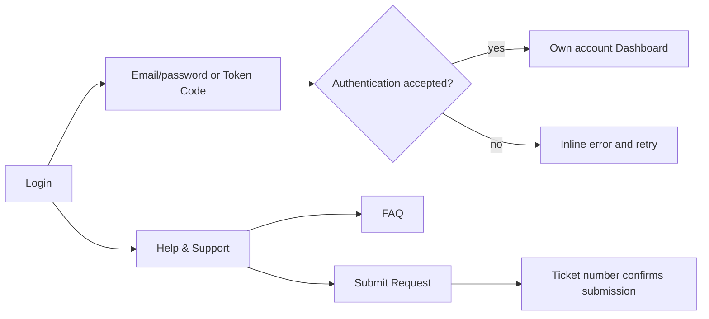
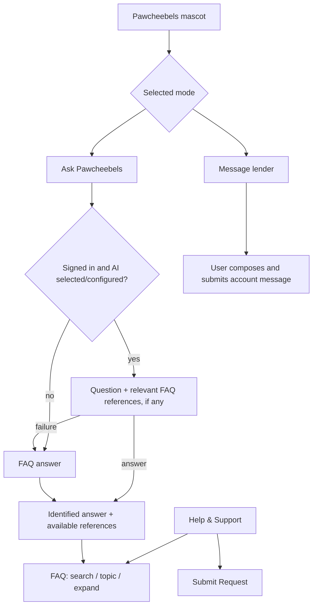

# User Flows

Baseline: October 14, 2026. Requirements: [FRD](FRD.md). UI: [UIRD](UIRD.md).

## Guest and sign-in

A guest can use the support form and FAQ without signing in. A signed-in user’s support email starts with the registered email. Signing out clears account support/assistant details from the guest view. Guest FAQ does not expose private account history or allow lender messaging. A support submission retains its draft when validation, connectivity or confirmation fails.

## Dashboard and transactions

1. Dashboard loads the account’s Current Balance Due group.
2. Select Next Balance Due or swipe to switch. Amount, item count, dates, breakdown and past-due advisory change together with a reduced-motion-aware transition.
3. Select the item count to open only that group’s items. Expand due dates and use Show fewer to collapse.
4. The advisory appears only when active-group overdue charge items exist. It summarizes distinct dates, earliest date and unpaid items, plus the current grace-period state.
5. Open Transactions: Installment Transactions appear before Straight Transactions. Select an installment group to view the schedule. Search/filter/sort without confusing transaction date and due date. Latest transaction date is the default.

## Payment proof and receipt

Payments / Submit Payment → select due dates and items → confirm requested allocation → attach supported proof → review OCR results or switch to manual entry → enter/correct amount, date, method and reference → submit → lender review status.

Confirmed submission produces acknowledgement details from the submitted proof and allocation. Download Proof and Receipt use the shared document controls. A receipt acknowledging submission is not confirmation of verified funds. Rejected proof supports correction where the existing flow permits it; pending proof may be withdrawn while retaining history.

## Invoice and document downloads

More → My Invoices → year/month → due date → generate → history → Download Invoice. The user may delete their own generated invoice after confirmation; lender-issued documents remain managed by the lender. Disbursement, proof, receipt and notification-attachment flows use download-only controls.

For every download: prepare/generate/fetch → visible loading → Download started notice → browser handoff. The browser chooses its save behavior and may show its own UI. Failure shows an error and releases the action. Saving completion is not confirmed by the app.

## Loan request

Request Loan → amount/term → bank and purpose → account/terms confirmations → review fees and monthly amortization → submit → Recent Loan Requests → expand details / schedule / History Timeline.

Timeline events are latest first and show actor/date where recorded. Submitted, Pending / Under Review, Coordinating with Bank, Bank Approved, Transfer in Progress and Completed describe progress; Declined / Rejected and Canceled are alternate terminal outcomes. Completed uses a green check. These are recorded statuses, not a bank transfer independently executed by the browser.

## Notifications and lender conversation

Notifications → search or category → update → mark read, Reply, Download attachment or open reaction picker. Reply is an authenticated lender-message action. A reaction records feedback. Download uses the common feedback flow.

Pawcheebels on Dashboard → Message lender → write message or attach file → Send → confirmed account conversation. The full Messages screen retains replies, attachments, reactions and user-side hide/undo behavior where implemented. A message is not sent merely by asking Pawcheebels a question.

## FAQ and Pawcheebels

FAQ initially shows five questions; Show more/fewer controls the complete filtered list. Source links reset filters, expand the referenced answer and bring it into view. Ask Pawcheebels displays FAQ or AI-assisted answer labels. Signed-in AI can answer greetings and general questions even without a FAQ match. App-specific policies rely on approved FAQ; uncovered app details suggest Submit Request or Message lender. General replies do not display invented FAQ references. External AI is optional and requires protected server configuration. Clear conversation removes in-memory assistant history; account change also clears it.

## Settings and recovery

Profile & Settings → active loans / next-payment summary / personal information / security / preferences / Help & Support. Next Payment opens the corresponding dashboard card. Theme, language preference and mascot visibility affect presentation.

On errors, preserve task context, show a recoverable message and allow retry. Pending actions block duplicate submissions. Results arriving after an account change are not applied to the new account. Service outages use the same recovery flow; reading legal notices or asking an FAQ question does not change financial records.

## Pawcheebels in Messages

More → Messages offers Ask Pawcheebels and Message lender. The assistant uses the same conversation and AI preference as the mascot and FAQ screen. Switching destinations preserves separate unsent assistant and lender drafts. Asking the assistant never submits a lender message; lender messages require the user to select Send. Account changes clear assistant state.
# Transfer to a receiving account

Dashboard → choose Current Balance Due or Next Balance Due → Pay by / View transfer accounts → receiving-account deck → swipe, drag or select a pagination dot → copy the account number or save its QR code → complete the transfer in the banking app → Payments → submit proof for lender review. Selecting a bank logo beneath the balance card starts the deck at that bank. The app does not initiate or verify the bank transfer through this deck.

## Saved payment confirmation

My Payment → select dues/items → confirm allocation → upload proof → review OCR values or enter manually → Submit proof of payment → saving/preparation animation → confirmed saved response → Proof of Payment Submitted pop-up → Save Image or Share → close → Recent Payments.

A failed save returns to the retained draft with an error. Coverage compares the submitted amount with the saved requested allocations; lender verification remains pending. Uncaptured bank/account rows are hidden. Payment date and submission time are shown separately. Full PDF acknowledgement access remains in Recent Payments. Unsupported native sharing provides a PNG download for sharing from the device.

## Session continuity

Sign in → use a borrower screen or draft → background synchronization/session renewal → continue in the same screen. A deliberate sign-out clears account data and returns to login. Published asset updates take effect on the next deliberate refresh rather than interrupting the active screen. Login feedback remains separated from the password field when valid or invalid text appears.

## Draft recovery and sign-in motion

Choose payment items → attach proof → OCR/manual entry → navigate away or reload → authenticate as the same borrower → return to My Payment → review restored draft → submit or explicitly discard. Failed submission retains the draft and retry controls. Confirmed submission clears it and opens the payment confirmation. Successful fresh sign-in shows the logo pulse grid, then the active screen; session restoration skips that animation. Slow general requests show magnetic dots; document operations keep their own progress animation.

## Borrower account and proof history

Create borrower profile → assign stable numeric reference → display it in account screens and acknowledgement receipts. A later name update retains the number. Submit proof → unapproved status palette → lender approves/rejects, or borrower selects Retract proof → confirm → busy feedback → updated proof history. Approved, rejected and withdrawn records have no retract action. History updates preserve any separate unfinished payment draft.
